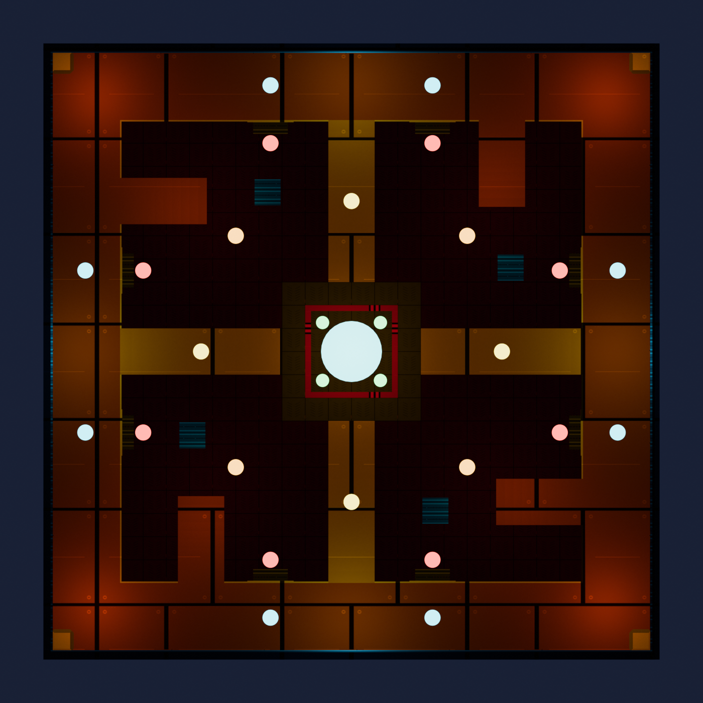

# 185 — The Battle Arena

> **v3 (2026-10-04): LEVEL 10 IS THE DEALER'S HOUSE (docs/207).** The last level runs `tod_house::run` (the Black Market parlour, the
> rigged last roll, the drain to one health under the corrupted dome, the Dealer's two-state fight) in place of the three waves and
> the Keeper; `TOD_ARENA_HOUSE` in _tod_arena.gsc, the branch after hold_tower. The readout gained HOUSE / DEALER flags (THE FINAL
> FIGHT / THE DEALER); the ride home charges from `level.tod_arena_depart`. Everything below stands for levels 1-9.

**STATUS v2.2 (2026-10-03): THE CRUCIBLE (v2: the room + the 0.8 s teleport, FULL BUILD OK 05:21:16) + THE READABLE FIGHT (v2.1: the readout, the cues, the gate tell, the mood lights; BUILT 13:18) + THE ROUND BADGE IS THE LEVEL (v2.2: the HUD's round badge reads BATTLE ARENA / LEVEL n for the whole fight; the "Build (v2.2)" block at the end of its section: BUILT 15:01 in -a0's FULL build 7). UNPLAYED.**

## v2 — THE CRUCIBLE (2026-10-03)

> "Currently the battle arena teleporter waits way too long to actually teleport please fix the
> latency. It doesnt line up. Also the battle arena needs to be acyually designs. Should be a unique
> fighting area. with no real spot to camp and have heights to allow vertical traversal for some
> characters. Really should play into the characters for skill gap but be super hard as well so
> spawns need to be thought out and structures"

### The teleport lines up

The cause was measured, not guessed. `tod_teleport::fx_burst` waits out its whole effect lifetime
before it returns, and v1 called it INLINE three times. The user's 2026-10-01 log:

| Moment | v1 (log) | v2 |
|---|---|---|
| Use the gate | 482.9 s | 0 |
| Charge sound starts | 486.5 s (+3.6 s, after the charge effect had already ended) | 0, with the effect |
| The jump | 489.5 s (+6.6 s) | **+0.8 s** (the transit pads' own charge) |
| Arrival flash | 492.65 s (3.15 s after landing) | two frames after landing |
| Wave 1 | 495.65 s | 3 s after landing |
| The ride home | 5.35 s (a 1.3 s inline charge + a dead 0.8 s, arrival flash 3.1 s late) | 0.8 s, flash two frames after |

Every `fx_burst` in `_tod_arena.gsc` is threaded now; `TOD_ARENA_CHARGE_SECS` 0.8 is LOCKSTEP with
`_tod_teleport.gsc` `TOD_TP_CHARGE_SEC`. `tools/test_battle_arena.js` TIMES both rides from the
script text and requires 0.8 s; run on the v1 code (kept as `tools/battle_arena_fixtures/arena_teleport_v1.gsc`)
it computes 6.6 s and a 3.15 s-late flash — the numbers in the user's log.

### The room

Design review renders (the real emitted brushes, the kit materials, the map's lights, player-eye
cameras; NOT BO3's bake): `art/battle_arena/review/{arrival,pit,ring,undercroft,overview,plan}.png`,
made by `tools/battle_arena_review/review_scene.js` + `preview.py`.

A 1664-square colosseum on three levels, every level reachable ON FOOT — a perch the horde cannot
walk to is the camp the user ruled out (the Archer's grapple already refuses a landing with no
navmesh under it, for the same reason):

| Level | Height | What it is |
|---|---|---|
| THE PIT | 0 | the open floor in four quadrants, a floor-to-roof PYLON in each (cover), EIGHT LIT GATES in its walls (the elites come through them) |
| THE RING | 120 | a running track round all four walls; its inner edge is an open ledge (drop into the pit anywhere); four PINWHEEL STAIRS climb to it, one per quadrant |
| THE SPOKES | 120 → 240 | four bridges rising from the ring's mid-walls to the centre, each with a flat landing half way, a solid beam under each flight |
| THE DAIS | 240 | the centre, high over the pit on four gold pillars; the party lands here round the arena's own teleporter, which also takes them home |
| THE UNDERCROFT | 0, under the dais | 224 of headroom, the pillars and the spokes' piers: close quarters |

No dead ends (the ring is a loop, every spoke joins two places, the dais has four ways on) and no
corner to back into (the pit's corners are the ring). The roof slot (below) keeps every ability
inside.

**THE SKILL GAP is the height.** The stairs are the slow way up for everyone. The fast ways:

| Class | What the room gives it |
|---|---|
| ARCHER | the grapple reaches any level from any level (every deck has navmesh, so it always bites); the landing buff rewards it; the ring and the dais give the bows long sightlines over the pit |
| BREACHER | the Fusion launch (300-620 up with the Explosive Fusion card) clears the ring (120) or the dais (240) from the pit; the C4 owns the stair and spoke chokes |
| WARRIOR | every ledge is a diving board: the slam drives straight down from the ring, a spoke or the dais into the pit crowd; Bash carries across a landing |
| NECROMANCER | no vertical move of its own: the helpers it binds take the stairs and spokes as lanes; it plays the pit and the undercroft |

Going DOWN is always free: every ledge is open and the arena takes **no fall damage**
(`arena_fall_guard`, active only while a fight runs and only inside the room).

### The spawns (THE DIRECTOR)

26 spawn points, every one on a flat deck (`battle_arena_layout.js` proves it at require time):
8 gates (pit), 4 open pit spots, 2 in the undercroft, 8 on the ring, 4 on the spoke landings. None on
the dais. Every ordinary spawn is scored (`best_spot` / `spot_score`, pure GSC, run by the gate):

- **never within 380 of any player** (3D) while a legal point exists, the farthest point when none is;
- **arrive soon**: the score peaks at 650 from the nearest player;
- **from behind**: + for every player NOT looking at it (outside ~60 degrees of their view);
- **from every side**: − for each zombie already up within 400 of it, so the horde converges;
- **never the same point twice running** while another is legal;
- **CAMPING**: a player who stays inside 200 units for 7 s is camping (`[TOD_ARENA] CAMP_START`) —
  spawns are pulled toward them and the next elite comes through the gate nearest them.

Elites come through the gates: the legal gate farthest from the party, never one of the last three
used, or the camper's nearest. The Keeper (level 10) arrives the same way.

### The dais overcharges

The one spot four players could hold is the dais (four spokes = four chokes). While a fight runs,
20 s after wave 1 and every 25 s after, its teleporter winds up (the charge effect + sound, 2.5 s,
"THE DAIS IS OVERCHARGING - GET OFF IT" the first time) and discharges: everyone still on it takes
40% of their max health, ordinary zombies on it die, elites take 15% (never the Keeper). A good party
lures the horde onto it and drops off at the wind-up.

### Harder

| Knob | v1 | v2 |
|---|---|---|
| zombies per wave, level 1 solo | 6 | 12 (+3 a level; Lv10 39, x the set's factor, x1.5 a co-op player) |
| arena zombie speed | the tower round's | full sprint from level 1 (`tod_zspeed_round_add`) |
| elites | none in wave 1 of levels 1-3; +1 every 4 levels | none in wave 1 of levels 1-2; +1 every 3 levels (Lv10: 4 of the set's kind a wave) |
| spawn gap / wave gap | 0.35 s / 4 s | 0.25 s / 3 s |

### Knobs (v2) — `_tod_arena.gsc` unless stated

| Symptom | Knob |
|---|---|
| The jump feels slow / fast | `TOD_ARENA_CHARGE_SECS` (LOCKSTEP `TOD_TP_CHARGE_SEC`), `TOD_ARENA_RETURN_SECS` |
| Zombies rise too close / too far | `TOD_ARENA_SPAWN_MIN` 380, `TOD_ARENA_SPAWN_IDEAL` 650 |
| Too many from behind | `TOD_ARENA_SPAWN_UNSEEN` 1.5 |
| Camping not punished enough / too much | `TOD_ARENA_CAMP_R` 200, `_CAMP_MS` 7000, `_CAMP_PULL` 3.0 |
| The dais too punishing / too soft | `TOD_ARENA_PURGE` (0 = off), `_PURGE_FIRST` 20, `_PURGE_EVERY` 25, `_PURGE_WARN` 2.5, `_PURGE_PCT` 0.40 |
| Too hard / too easy | `TOD_ARENA_ZOMBIES_BASE` 12, `_ZOMBIES_LV` 3, `_ELITE_EVERY` 3, `_QUIET_LEVELS` 2, `_SPAWN_GAP`, `_WAVE_GAP`, `_HP_STEP`, `_DMG_STEP` |
| The room's shape | `tools/battle_arena_layout.js` (regen + FULL build) |

### The roof: a slot, not a gap

A fully sealed room is invisible in this toolchain (Umbra classes it as the inside of a solid —
see "The vented roof" in the layout). The v1 vent was a 128 gap over the walls; now that the Breacher
and the Archer can reach the ceiling, that gap would let them out. The linker prints Umbra's own
setting, `small_hole=4.000`: any opening of 4 units or more is open air to it. The gap is a **24-unit
slot**: open to Umbra, closed to any player body (crouched ~50). No clip is used, so the vent never
depends on how Umbra treats clip.

THE PROOF IS AN AIR FLOOD, NOT THE LINK LOG'S COUNT. The first v2 link's `Filtered N/M inside
clusters` rose 245/247 -> 256/258: the same number that went up when the v1 box went invisible, so the
count alone cannot tell a sealed room from dead air. `test_battle_arena.js` section 3b (every build)
floods the air of the GENERATED .map at Umbra's own 4-unit hole size (any voxel that touches a visible
brush is solid) and requires every spawn point, arrival and walk probe to sit in air that reaches the
void; then it lids the slot and requires the same flood to find the room sealed (so the slot is the
room's one vent, and the check can fail). On this build the room is open, and the rise is dead air:
four sealed 8 x 8 x 228 columns behind the corner chamfers, plus small enclosures at Umbra's scale.
No camera can be in them.

### The conduit inlays stay where they were

`tools/art_cohesion/conduit_layout.js` places the arena's eight power-wire inlays on the `battle arena
floor` brush's grid and skips covered grid points. That brush keeps its v1 extent, and the SW stair,
the SW pylon and the W spoke's pier cover exactly the three points the old walls covered, so the baked
`tod_conduit_arena` model is unchanged (`conduit_layout.js --check` green; no re-export).

### Gates (v2)

- `tools/test_battle_arena.js` (build_map.ps1, after test_ambush): the jump timed from the script, the
  v1 fixture as the negative control, the director's shipping GSC on the generated room (MIN distance
  over random parties on all three levels, backs over faces, the camper pull, the spread, the repeat
  rule, the elite gate), the waves, the fall guard, the room data, THE ROOM'S AIR (section 3b, the
  air flood above, with its lidded-slot negative control; added 05:35, after the build below),
  lockstep, 13 mutants.
- `lint_tod_geometry.js`: arena ledges (an arena edge over arena floor up to 256 below) are counted and
  printed, not gated; an arena edge over nothing is still a hole (`lint_tod_geometry_selftest.js`
  deletes a floor apron and requires the holes back). The arena's chamfered solids are decoded.
- `lint_tod_navmesh.js`: every arrival, spawn point AND one probe on every surface (pit, ring, stairs,
  spokes, landings, dais: `arena_nav_probes()`, 30 points) on ONE navmesh component.

### The sky fleet's lanes

The sky ships' flight lanes are generated from the live map and must stay 1,500 units clear of every
brush (docs/192). The bigger room (outer edge 648 -> 936, roof 532 -> 604) blocked 193 dreadnought lane
bands near the arena, so `node tools/sky_ships/gen_lanes.js` regenerated them (1,499 bands clear;
`test_sky_ships.js` and `test_jump_title.js` green). Any later change to the arena's size or height
needs the same step before a build.

### Logs (v2, dev) — `[TOD_ARENA]`

`INIT rev=2 ... spawns gates charge_s purge` · `CHARGE ... secs` · `JUMP ... ms_since_use` (expect
~800) · `ENTER ... ms_since_use` · `SPAWN` (first 4 a wave: spot, kind, camper_pull) · `WAVE_SPAWNED
... by_kind: ... camper_pulled` · `GATE index at camper` · `CAMP_START / CAMP_END` · `PURGE_WARN
players_on_dais` · `PURGE players_hit zombies_killed elites_hit` · `PURGE_SKIP` · `FALL_GUARD` ·
`RETURN ... ride_ms` (expect ~800).

### Known limits

- No zombie climb/jump traversal links: everything is reached by stairs. The horde's own table has the
  Giant's climb-up, but the elites map it to a melee animation and the Keeper to a teleport whose
  mocomp registration is unverified, and zombie traversal has never been seen working in this map. A
  later pass can add climb links along the ring's ledge once a native test proves them.
- The corner chamfers seal four 8 x 8 x 228 air columns against the walls behind them: dead air
  and a few hidden faces in the bake, harmless. A later geometry pass can push the chamfers into the
  corners as solid wedges (a FULL build).
- The look in game (the bake, the light levels) is unverified until the user plays it.

### Build (v2)

FULL BUILD OK 2026-10-03 05:21:16 Eastern (tmp/battle_arena_v2/full2.log; build 1, full1.log, stopped
at the sky-lane gate before any compile, see "The sky fleet's lanes"): .ff 229,095,232 B, fresh BSP,
LED 239,451,348 B (237.3 MB before: +2.1 MB for the bigger room), navmesh, fresh Umbra (0 tiles from
cache). Ran INSIDE it: BATTLE ARENA OK (38 checks, 13 mutants), NAVMESH GATE OK with `BATTLE ARENA: 4
arrivals + 26 spawns + 30 surface probes in component 1`, SKY LANES OK (1,499 bands), PURSUIT OK,
HAVEN GATE OK, the geometry lint (no regression; arena ledges 628, counted). The ledger carries
scriptparsetree `_tod_arena.gsc` / `_tod_arena_data.gsc` / `_tod_sky_lanes.csc`; scripts / zone_source
/ ui deployed = repo, nothing synced after the .ff; the 8 known-waived linker lines only. Section 3b
(the air flood) was added after this build and passes on it. SUPERSEDED AS THE TEST .ff by session -a0's FULL BUILD OK 06:03 (tmp/war_damage/full2.log; war damage; .ff 06:01:44, FF 229,314,304 B; geom_key REUSED this build's BSP / LED / navmesh), verified here: BATTLE ARENA OK 41 (the air flood ran inside it), the navmesh gate's arena line on the reused mesh, SKY LANES OK, its ledger carries _tod_arena / _tod_arena_data / _tod_sky_lanes, deployed = repo (the map at the tools root too), nothing synced after. UNPLAYED.

## v2.1 — THE READABLE FIGHT (2026-10-03)

> "Give the arena one more pass from a players perspective and see how we can continue to enhance"

v2 fixed the room and the jump; this pass fixes what the ROOM TELLS YOU. Walked as a player, the
v2 fight was mute: you landed, zombies came, you did not know which wave you were in, how many
were left, where the next elite would appear, or when the dais was about to bite someone who had
just stepped onto it. Every level also looked the same. v2.1 answers each of those with something
you see or hear, nothing in the rules changed.

### The readout (`TodArena.lua`, the `tod_arena` event)

Top centre, in the map's typeface, for the whole fight:

| Line | Reads | Colour |
|---|---|---|
| wave | WAVE 2 OF 3 (GET READY in the 3 s breath before wave 1) | cyan |
| count | 14 LEFT, ticking on every kill; **RED at 3 or fewer** (hunt them); WAVE CLEARED / LEVEL CLEARED in gold; THE KEEPER in red while the boss lives | white / red / gold |

(v2.1 also had a gold title row, BATTLE ARENA - LEVEL 3 OF 10, above these; v2.2 moved the level onto
the HUD's round badge, where the player already looks for it, and the row is gone.)

"Left" = the enemies not yet risen plus the ones still up (`hud_left`, a pure function the gate
runs), so it starts at the wave's full size while the horde is still climbing out. The server sends
`( show, level, levels, wave, waves, left, flags )` as seven ints: `test_tod_native_api.js` accepts
only call shapes a stock script uses in the same VM, and stock's widest `LuiNotifyEvent` carries
seven values (MP's `show_outcome`) — six would have failed the gate. The state is re-sent every 2 s
(a rebuilt HUD hydrates); the widget ignores a re-send that changes nothing (the harness fails a
module that ticks on every re-send). A child of AetheriumHud, so the card deal's veil hides it with
the rest of the HUD. Elements built once, only tweened (the pool rules).

### The cues (`tools/battle_arena/make_sounds.py`, generated)

| Cue | When | Where |
|---|---|---|
| `tod_arena_wave` | a wave begins: a low brass swell into a deep drum hit | 2D, every player |
| `tod_arena_clear` | a wave is cleared (never the level's last): two bright bells rising | 2D |
| `tod_arena_level` | the level is cleared: a three-note brass fanfare with a crystal tail | 2D |
| `tod_arena_gate` | a gate opens for an elite: a latch, a rising electric whine, a heavy clank | **3D at the gate** |

Seeded numpy, byte-identical on every render, `--check` in the build; alias rows on BUS_FX with no
context columns; registered in the sound zone config. Synthesised stand-ins made to the right
length, shape and loudness: an authored set replaces them BY NAME.

### The gate tell (`gate_rise` / `gate_rise_think`)

An elite's gate now charges for `TOD_ARENA_GATE_TELL_SECS` (1.0 s: the teleporter's own wind-up
effect at the gate mouth + `tod_arena_gate` from it), flashes, and THEN the elite rises in it. The
room says where the threat is coming from before it arrives. A wave's gates open together (each on
its own thread; the horde starts climbing out meanwhile), and `spawn_wave` waits for every charging
gate before the wave counts as spawned. The Keeper's gate plays the cue too (his portal and scream
follow as before).

### The mood lights (`mood_start` / `mood_index`)

Five glow hosts on the todPerkGlow lane (the power wave's), GENERATED into `arena_mood_orgs()`:
one over each pylon collar and one over the dais (always LAST: `mood_dais` addresses it). Their
colour is the level's: teal for 1-3, yellow 4-6, orange 7-8, red 9-10 (`mood_index`, pure, gated
monotone). During the overcharge's 2.5 s wind-up the dais light goes WHITE, so the warning is
visible from anywhere in the room, not only to the players already standing on it.

### Two fairness fixes

- THE OVERCHARGE warned only the players on the dais as the wind-up STARTED; anyone who stepped on
  during the 2.5 s took the hit with no warning. The wind-up now polls every 0.25 s and warns
  whoever steps on (`PURGE_WARN_LATE`), the first time each.
- THE CHAMBER tells a player the level before they commit: standing inside the floor-40 field for
  2 s prints `BATTLE ARENA - LEVEL N OF 10`, once per level per player, timed to land after the
  haven's own SAFE ZONE label. A free lane (no hint string).

### See it without the game

`python tools/ui_mockup/render_arena_hud.py` runs the REAL widget under the LUI mock
(`mock_lui_anim.lua`), drives it with the server's events and draws every state over the arena's
own review render: `art/battle_arena/review/hud_*.png` + `hud_contact.png`.

### Knobs (v2.1) — `_tod_arena.gsc`

| Symptom | Knob |
|---|---|
| The count turns red too early / late | `TOD_ARENA_HUD_HOT` 3 (LOCKSTEP `HOT` in TodArena.lua) |
| A rebuilt HUD stays blank too long | `TOD_ARENA_HUD_RESEND_MS` 2000 |
| The gate tell too long / short | `TOD_ARENA_GATE_TELL_SECS` 1.0 |
| The mood colours | `mood_index()` bands; `TOD_ARENA_MOOD` 0 = off; `TOD_ARENA_MOOD_WARN_IDX` 8 (white) |
| The chamber notice too eager | `TOD_ARENA_NOTICE_MS` 2000 |
| The cues' levels | `SOUNDS` volumes in `tools/battle_arena/make_sounds.py`, then re-run it |

### Gates (v2.1)

- `tools/test_battle_arena.js` section 4b: the event precached and seven-valued, the flag bits and
  the hot threshold LOCKSTEP with the Lua, the widget attached / veiled / zoned / in the lifetimes
  harness, `hud_left` and `mood_index` run as shipped, the mood hosts on real surfaces with the dais
  last, the gate tell's order (charge, cue, wait, flash, rise) and that no set elite bypasses it,
  the horn / sting / fanfare at their beats, the late-stepper warning, `wave_begin` before the boss;
  7 new mutants (an inline gate charge, the rise before the flash, a count that reads under the
  ones up, a mood that never deepens, a bare `spawn_elite`, a wind-up that stops warning, the last
  wave stinging like the others), 20 in all.
- `tools/test_arena_hud.lua` (the build's Lua harness list): the widget driven through its
  subscription — show / wave flash / tick / hot / cleared / boss / level / hide / harmless inputs /
  close; 2 negative controls. `test_ui_lifetimes.lua` builds and closes it 20 times leak-free.
- `tools/battle_arena/make_sounds.py --check` (build_map.ps1, after the arena gate).

### Logs (v2.1, dev) — `[TOD_ARENA]`

`HUD show= level= wave= left= flags=` (on every flagged push and the hide) · `GATE_TELL kind= at=
secs=` · `MOOD level= index= hosts=` · `PURGE_WARN_LATE n= player=` · `NOTICE player= level=`.

### Build (v2.1)

-GscOnly BUILD OK 13:18 (tmp/battle_arena_v2/gsc_v21c.log; the THIRD attempt: the first (12:46) died at -09's ability-FX gate on 30 un-zoned effects it had just generated, the second (12:51) at -a4's haven gate on a layout self-assert it had just edited - both peers' mid-edit files in gated paths, both fixed by them before the third sync at 13:08): .ff 13:18:01, FF 229,325,888 B, on the 05:18 BSP / LED / navmesh. Ran INSIDE it: BATTLE ARENA OK 66 / 20 mutants, ARENA SOUNDS OK 4, ARENA HUD OK + HUD owner lifetimes 160 (TodArena inside), arity 135 files, native API 10,371 sites. The 13:18:01 ledger carries scriptparsetree _tod_arena.gsc + _tod_arena_data.gsc and rawfile todarena.lua; the loaded bank rebuilt 13:17:14 (159.4 MB, +0.6 MB) indexes all four tod_arena_* stems; every arena file verified deployed = repo at 13:19 (the cues at the tools-root sound_assets); THEN at 13:20:54 session -a4's guarded-haven landing (docs/202 v3) INSERTED six lines into the repo's _tod_arena.gsc (a "haven_corrupted" refusal + the ^1defeat the guardians hint + a "corrupted" pad state, all reading level.tod_haven_locked_fn; nothing of v2.1 removed or reworded - BATTLE ARENA OK 66 re-run on it) and -a0's FULL build synced that tree at ~13:23 (its sync preserves mtimes, so a repo-vs-deployed diff reads green): those six lines are NOT in this .ff - they ride -a0's FULL build (tmp/war_damage/full3.log), which supersedes this .ff as the test .ff once -a0 reports BUILD OK and the arena rows; the 8 known-waived linker lines only. NOT in this .ff (edited after its sync, theirs to build): -a0's war-damage phase 2 (_tod_war_sky.csc, the entry #usings, the zone's war block, tod_war.csv) and -09's staged ability sounds. UNPLAYED.

---

## v2.2 — THE ROUND BADGE IS THE LEVEL (2026-10-03)

User: *"I think in the Battle Arena we should replace the round HUD with Battle Arena / Level 1 etc
... Since rounds dont count in there and its a static difficulty of progression through the battle
arena levels."*

The round means nothing in the arena: the tower's round stands still while the party is away, and
the fight is ten levels of fixed difficulty. So for the whole fight the HUD's round badge (HUD V2's
status plate in `tod_upgrade.lua`: the top-left badge that reads ROUND n, docs/182) wears an ARENA
TWIN and shows the level:

    BATTLE ARENA      the badge's pill, where ROUND was
    LEVEL             a caption along the top of the number window
    3                 the level, where the round number was: a little smaller, under the caption

### The badge (`tools/battle_arena/make_badge.py`, generated)

- `i_tod_h2_arena_badge` / `_rampage` are cut from the shipped round badges, never painted by hand:
  the pill is redrawn wider in the badge's OWN colours (fill, outline, the dark inner line — sampled
  from the source; the rampage twin's reds come out of the rampage badge), the words are typeset from
  the map's glyph sheets exactly as TodGlyphRow lays them out in game (cap 11 art px = the badge's
  own caption size, supersampled 4x), and every other pixel is the source's. `--check` regenerates
  in memory and fails the build on any byte of difference, a missing GDT block, zone line or Lua
  registration. Review: `art/battle_arena/review/badge_review.png` (round beside arena, both dresses).
- The number: `paintRound2` draws `arenaLvl` at `TOD_ARENA_NUM_CAP` 12.75 / `TOD_ARENA_NUM_BASE` 55
  (LOCKSTEP `make_badge.py WINDOW_TEXT`: the caption owns the window's art rows 60..71, the number
  rows 86..120), the round's own 17 / 53 otherwise; level 10's two digits fit. The rampage dresses
  swap with the plate's `todRampage` as before: ONE chooser, `badgeImage()`, picks round / arena x
  normal / rampage, read by `drawLuckV2` and the arena lane alike.
- The lane: the plate subscribes to the SAME `tod_arena ( show, level, ... )` event TodArena.lua
  reads. show 1 + a level = arena dress + the level; show 0 (the ride home) = the round badge + the
  round, including a round that advanced meanwhile (tod_round keeps arriving underneath and is
  repainted the moment the arena hands back). Change-gated: the 2 s re-send repaints nothing.
- `TodArena.lua` lost its title row: the top-centre readout is WAVE w OF 3 / N LEFT (moved up to
  y 44..106); the level is the badge's. The chamber notice still prints BATTLE ARENA - LEVEL N OF 10
  before you commit, and the pause menu's ROUND box is untouched (it reads `CoD.TodRound`).

### Gates (v2.2)

- `tools/battle_arena/make_badge.py --check` (build_map.ps1, right after the cue check).
- `tools/test_arena_badge.lua` (the build's Lua harness list): the REAL upgrade menu driven through
  tod_round / tod_arena / todRampage — the round badge + the round by default; the arena twin + the
  level (smaller, under the caption, inside the window; level 10 fits) while show is 1; the rampage
  dresses in and out of the arena; a re-send repaints nothing; a round change during the fight stays
  off the badge and is there on the ride home; no args / an unrelated event / show with no level
  leave the badge alone. 2 negative controls: a plate that re-dresses on every re-send, a badge that
  ignores the arena.
- `tools/test_battle_arena.js` 4b: both images registered / zoned / in the GDT / on disk, the plate's
  subscription, the change gate, the one chooser, the number under the caption (LOCKSTEP), TodArena
  two rows and no level, the build running both new checks. `tools/test_arena_hud.lua` re-pinned to
  two rows; a level-only change is a silent re-send there.

### See it

`python tools/ui_mockup/render_arena_hud.py` draws the badge cluster too now: the arena twin, the
level laid out by the real TodGlyphRow with the plate's own arithmetic, the luck plate beside it —
`art/battle_arena/review/hud_*.png`, `hud_contact.png`, `hud_badge_corner_1080p.png` (the corner at
the size a 1080p player reads it).

### Knobs (v2.2)

| Symptom | Knob |
|---|---|
| The level number too big / small, or riding the caption | `TOD_ARENA_NUM_CAP` / `_BASE` in tod_upgrade.lua (the harness pins it under the caption) |
| The badge's words or their size | `PILL_TEXT` / `WINDOW_TEXT` / `PILL` in make_badge.py, re-run it (a FULL build: images) |

### Build (v2.2)

Rode session -a0's FULL BUILD OK 15:01 (tmp/war_damage/full7.log; build 7 - build 6 died at the link at 14:41 on -a4's _tod_haven.gsc ternary, found and reported from this session, fixed by -a4 at 14:44): .ff 15:01:16, FF 229,403,200 B, geom_key reused build 6's fresh bake (LED 239,400,329 B). Ran INSIDE it: GSC STRICT LINT OK 135, BATTLE ARENA OK 80 / 20 mutants, ARENA SOUNDS OK 4, ARENA BADGE OK (2 badges = the generator; GDT + zone + Lua wired), ARENA HUD OK, ARENA BADGE HUD OK, HUD owner lifetimes 160. The 15:01:17 ledger carries image i_tod_h2_arena_badge + i_tod_h2_arena_badge_rampage (fresh .iwi converted 15:00:50), rawfile tod_upgrade.lua + todarena.lua, scriptparsetree _tod_arena.gsc + _tod_arena_data.gsc; all four tod_arena_* stems in the fresh loaded bank (15:00:18, 160.5 MB); every v2.2 input deployed = repo, nothing synced after the .ff; the 8 known-waived linker lines only. It also carries -a0's war damage phase 2, -a4's guarded haven (incl. its six lines in _tod_arena.gsc) and -09's docs/206. NOT in it: a fourth session's Der Eisendrache jump pad (the zone, _tod_jumppad.gsc, the regenerated map + data scripts, written 15:04, after the .ff) - theirs to build.. SUPERSEDED AS THE TEST .ff by -a4's haven v4 FULL BUILD OK 17:46 (tmp/haven_v4/full1.log; .ff 17:44:19, FF 229,771,520 B, fresh compile + bake), verified here: image i_tod_h2_arena_badge + _rampage, rawfile tod_upgrade.lua + todarena.lua, scriptparsetree _tod_arena / _tod_arena_data in its ledger, the four tod_arena_* stems in its loaded bank, deployed = repo, nothing synced after; the floor-40 chamber grew with the haven field to (92, 92) r 332 (BATTLE ARENA OK 80 on that tree). UNPLAYED.

---

## v1 (2026-09-27, history)

**STATUS (2026-09-27 10:45 Eastern): BUILT: the combined FULL build (tmp/map_design_build/full3.log, BUILD OK, .ff 10:38:34) carried the arena, its navmesh gate passing (`BATTLE ARENA: 4 arrivals + 8 spawns in component 27`); then this session's -GscOnly BUILD OK 10:45:04 Eastern (tmp/battle_arena/gsc1.log) added the stuck-straggler watchdog: FF 196,343,232 B, 8 known-waived, scripts/ui/zone_source diffs clean, nothing synced after, `_tod_arena.gsc` + `_tod_arena_data.gsc` in the ledger. UNPLAYED.**

Earlier note:
The tower-design session's FULL build (tmp/map_design_build/full3.log, started 10:24) synced this
tree: geometry lint OK with the arena bucket, and after cod2map `BATTLE ARENA: 4 arrivals + 8
spawns in component 27; floor-40 chamber checked` / NAVMESH GATE OK. Confirm its BUILD OK line and
that the ledger carries `_tod_arena.gsc` + `_tod_arena_data.gsc` before playing.

## What the user asked for (2026-09-27)

> "the entrance will actually be on floor 40 ... some kind of teleporting chamber that everyone
> can go in and it can be activated on the inside ... you'll be teleported off into a battle arena
> ... right now it could just be a little square ... rounds of enemies and they will get stronger
> each round ... level one ... all the way to level 10 ... a little bit of randomization, so one
> round might be zombies and manglers ... one set where maybe it's doppelgas and amalgam ... the
> only difference is that on each level that round might have more health, stronger hits ... when
> you succeed everyone will get a card and then you'll be sent back to the tower"
>
> "it will cost 500 per teleport and it will go to the new teleporter bay at the top of tower"
>
> "floor 40 doesnt have a tower teleporter just a chamber for the battle arena teleporter"

The user's answers to four questions:

| Question | Answer |
|---|---|
| Floor 40's transit pads | The chamber REPLACES them (no floor-40 pad; the top bay keeps 30/20/10) |
| Levels per trip | ONE level per trip: trip 1 = level 1 ... trip 10 = level 10 |
| A wipe in the arena | GAME OVER (like anywhere else) |
| Who must be in the chamber | EVERY living player |

The transit network is therefore: top bay <-> floors 30 / 20 / 10, floor 1 (the base pad)
<-> the crown, and floor 40 = the arena chamber.

## How it plays

1. **The chamber.** Floor 40's lounge spur platform (288 x 288) is walled and roofed; the
   walkway's 160-wide opening is its door. The teleporter device sits on the pad inside.
   Prompt: `BATTLE ARENA - enter the arena [Cost: 500]` (`power required` before power,
   `conquered` after level 10). Everyone playing (downed included) must be inside; one player
   holds USE and pays 500. Refusals sound; "EVERYONE MUST BE INSIDE THE CHAMBER" prints.
2. **The charge.** 3 s of teleporter charge FX + sound, a "BATTLE ARENA - LEVEL N" banner.
3. **The tower holds.** Stock round spawning stops (the `spawn_zombies` flag); every tower
   enemy is deleted, ordinary zombies refunded to the round. The round cannot advance while
   the party is away.
4. **The arena.** A 1024-square walled, roofed room far south-west of the map. The party lands
   on four spots round the centre, facing outward. Three waves; each is killed to the last enemy
   before the next (4 s breath between).
5. **The win.** Downed players are revived; "ARENA LEVEL N CLEARED"; the world freezes and
   every player is dealt an upgrade card (the trials' `run_upgrade_event`); then the party is
   sent to the top bay's arrival spot and the tower resumes. Level N+1 is next.

## Level 10's last wave is THE KEEPER (2026-09-28)

User: "He is the wave 10 in the battle arena." Waves 1 and 2 of level 10 are
normal; wave 3 is the Keeper boss with his soul lines and his escort elites, on
top of that wave's usual zombies and set elites. `boss_wave` / `boss_escort` in
`_tod_arena.gsc`, the boss in `_tod_keeper.gsc`. Full design: [docs/186](186_keeper_boss.md).

## Enemy sets (one drawn per trip, never the same twice running)

| Set | Zombies per wave | Elites per wave |
|---|---|---|
| zombies and manglers | x1.0 | 1 Mangler (+1 every 4 levels) |
| zombies and doppelghasts | x1.0 | 1 Doppelghast (+1 every 4 levels) |
| the hunters | x0.5 | 1 Mangler + 1 Doppelghast (+1 each every 5 levels) |
| the horde | x1.6 | none |

Levels 1-3 open with a horde-only first wave. Zombies per wave = (6 + 2 x (level - 1)) x the
set's factor x (1 + 0.5 per extra player). **The Amalgam is not in the map yet**; add a set row
(`register_sets()` in `_tod_arena.gsc`) when it is ported.

## Level scaling

| Level | Enemy health | Enemy hits |
|---|---|---|
| 1 | x1.00 | x1.00 |
| 5 | x2.00 | x1.60 |
| 10 | x3.25 | x2.35 |

Health multiplies the ordinary zombie's normal (round-based) health, and the elites' 5-round-
zombie figure. Hits multiply in `_tod_bosses::boss_player_damage`, before the defensive domains.

## Knobs (one per symptom) — `_tod_arena.gsc`

| Symptom | Knob |
|---|---|
| Too hard / easy late | `TOD_ARENA_HP_STEP` (0.25), `TOD_ARENA_DMG_STEP` (0.15) |
| Too many / few zombies | `TOD_ARENA_ZOMBIES_BASE` (6), `_LV` (2), `_COOP` (0.5) |
| Elites too tanky | `TOD_ARENA_ELITE_UNITS` (5) |
| Waves drag | `TOD_ARENA_WAVES` (3), `TOD_ARENA_WAVE_GAP` (4 s) |
| Price | `TOD_ARENA_COST` (500) — and the literal in the ready hint |
| Room size / place | `tools/battle_arena_layout.js` `ARENA` (regen + FULL build) |

## Where it lives

| Piece | File |
|---|---|
| All numbers for the chamber, the room and the return | `tools/battle_arena_layout.js` |
| Chamber walls on floor 40 (rails -> walls + roof) | `tools/gen_tower_map.js` breather block (`isChamber`) |
| Arena geometry, zone, seeds, lights, data file | `tools/gen_tower_map.js` section 6z |
| GENERATED anchors | `scripts/zm/zm_tod2_cybercity/_tod_arena_data.gsc` |
| The chamber + the fight | `scripts/zm/zm_tod2_cybercity/_tod_arena.gsc` (`tod_arena::init` from `_tod_main`) |
| `arena_zone` creation | `zm_tod2_cybercity.gsc` `usermap_test_zone_init` (`zone_init`, disabled until used) |
| Stronger hits | `_tod_bosses.gsc` `boss_player_damage` (`level.tod_arena_dmg_mult`) |
| Prompt card routing | `ZMCursorHintNew.lua` `TOD_NOUNS` "battle arena" |
| Floor 40 out of the transit network | `tools/tower_transit_layout.js` `PADS` (+ contract/test counts 10 -> 8) |

While a fight runs `level.tod_trial_box` is the arena room: that holds the normal-round
Mangler/Doppelghast director and keeps every elite relocation inside the room.

## Gates

- `lint_tod_geometry.js`: the arena is its own island bucket (like the spire): every arena node
  must be walkable from the arena floor; its nodes do not count as detached tower.
- `lint_tod_navmesh.js`: after cod2map, every arena arrival and spawn point must stand on ONE
  navmesh component, and the floor-40 chamber must share floor 40's component. Against the
  pre-arena navmesh it fails with "has NO navmesh" on all 12 points (the negative control).
- The generator throws if the arena crowds any other brush (512 margin), leaves the sky seal or
  the umbra volume, if a riser is within 165 of an arrival, or if floor 40 also carries a
  transit pad.
- `test_tower_transit.js` asserts 8 routes and floors 30/20/10.

## Logs (dev) — `[TOD_ARENA]`

`INIT` (chamber / arena / return positions) · `STATE ready|power|busy|done` · `DENY reason=
busy|conquered|no_power|world_paused|trial_running|not_all_inside|no_money` · `START payer cost
level players` · `CHARGE level set` · `HOLD spawn_flag_cleared deleted refunded` · `ENTER level
set party hp_mult dmg_mult zombies/wave` · `WAVE_START / WAVE_SPAWNED / WAVE_WAIT / WAVE_CLEAR` ·
`ELITE kind hp ent at` · `SPAWN_FAILED` · `WIN` · `DEALT` · `RETURN` · `RELEASE` ·
`ABORT reason=no_zone` (refunds the 500). · `STRAGGLER_KILL` (no kill for 60 s -> stuck ordinary zombies removed, `TOD_ARENA_STALL_MS`; so a stuck enemy can never trap the party). The watchdog was added after full3's sync: it needs a -GscOnly after that build.

## Known limits (not built yet)

- The room is a placeholder square (the user will have it built out later).
- Partner robots and Necromancer helpers stay in the tower during a fight.
- A player who bled out (co-op spectator) stays out until the next round turns, after the return.
- Music: the boss track ("115") plays in the arena; on the return a random already-unlocked floor track plays (2026-09-28, `_tod_atmosphere::arena_music_end`).

## Build (for any later rebuild)

FULL build (brushes + zone + navmesh). Carries: the arena + chamber, floor 40's pad removed
from the transit network, the geometry/navmesh gate additions. It must also carry the peer's
transit bay / broken tower work (same generator; the regen already contains both). After the
build: `node tools/lint_tod_navmesh.js` must print `BATTLE ARENA: 4 arrivals + 8 spawns in
component N`, and the ledger must carry `_tod_arena.gsc` and `_tod_arena_data.gsc`.
